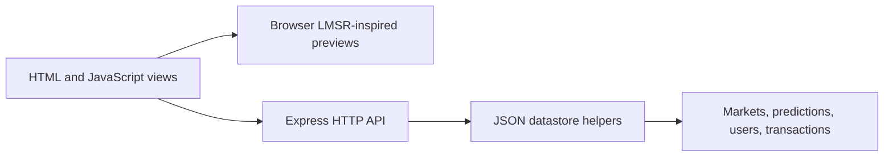

# Samsa Prediction Markets

A local prediction-market prototype exploring probability updates, simulated trades, and portfolio tracking. Built with a JavaScript frontend, Node.js/Express API, JSON persistence, and JavaScript/Python pricing experiments.

**Scope:** simulated trading for engineering exploration. This repository does not demonstrate production operation, real-money market services, or a deployed exchange.

## Problem and key features

Samsa explores how users can compare event outcomes and inspect the effect of a simulated trade on probability and risk.

- Market browsing, category filters, binary and multiple-outcome market records.
- Trade previews and a portfolio interface.
- Market creation, prediction recording, and manual outcome resolution APIs.
- A binary LMSR-inspired engine with liquidity, risk-weighted pressure updates, and rebate calculations.
- File-based storage that makes prototype state easy to inspect.

## Pricing implementation and technical decisions

The browser engine in [lmsr-engine.js](js/core/lmsr-engine.js) computes:

```text
p(YES) = exp(qY / b) / (exp(qY / b) + exp(qN / b))
pressure change = stake * (1 - p(YES))
```

`b` controls price sensitivity; a trade updates the selected side's pressure. The engine also computes win/loss previews and exposes market state through `LMSRMarketManager`. A Python counterpart lives in [lib/lmsr.py](lib/lmsr.py).

This is an **LMSR-inspired risk-pressure simulation**, not a complete standard LMSR cost-function market maker. The binary engine does not establish multi-outcome LMSR support.

**Backend distinction:** the default [Express server](server.js) does not call this pricing engine. It recomputes outcome percentages from each outcome's share of total stakes, accepts client-provided odds, and resolves losing predictions with zero return. Those semantics differ from the browser's rebate previews. The alternative [Flask server](server.py) includes its own LMSR paths, but is not started by `npm start` and is not interchangeable with the Node backend.

## Architecture and stack



| Path | Responsibility |
| --- | --- |
| [index.html](index.html), [js/features](js/features) | Browser interface and feature views |
| [js/core/lmsr-engine.js](js/core/lmsr-engine.js) | Binary pricing and settlement previews |
| [server.js](server.js) | Express routes, validation, prediction updates, resolution |
| [lib/datastore.js](lib/datastore.js) | JSON reads/writes and transaction helpers |
| [data](data) | Committed local state |
| [Entities](Entities) | Entity schemas; not evidence of runtime enforcement |
| [server.py](server.py), [lib/lmsr.py](lib/lmsr.py) | Alternative Python implementation |

JSON storage reduces setup cost but has no transactional guarantees, locking, or multi-instance coordination. Pricing consistency and authoritative server-side validation are the next architectural priorities.

## Getting started

Use Node.js 22 and npm:

```bash
git clone https://github.com/Advaith-1506/samsa.git
cd samsa
npm ci
npm start
```

Open [http://localhost:3001](http://localhost:3001). For auto-reload, use `npm run dev`. Windows users can also inspect and run [start-samsa.bat](start-samsa.bat).

Leave Stripe credentials unset for the local simulation. Payment integration code exists, but is not required for this walkthrough and was not exercised in the audit. Keep any provider credentials in an untracked `.env`.

For frontend-only browsing, serve the repository with a local static server; local JSON fallback does not establish full backend parity.

## API highlights — Node/Express

| Method | Endpoint | Purpose |
| --- | --- | --- |
| GET | `/api/health` | Service health |
| GET | `/api/markets` | List markets |
| GET | `/api/markets/trending` | Active markets ordered by total volume |
| GET | `/api/markets/category/:category` | Category filter |
| GET | `/api/markets/:id` | Market detail |
| POST | `/api/markets` | Create a market with at least two outcomes |
| GET | `/api/predictions` | List predictions; optional `market_id` query |
| POST | `/api/predictions` | Record a simulated prediction |
| POST | `/api/markets/:id/resolve` | Set the winning outcome and update prediction status |
| GET | `/api/users/:id/balance` | Derive a prototype balance from local records |

Inspect handlers in [server.js](server.js) for payloads. Creating markets, predictions, and resolving outcomes changes committed JSON data; use disposable local state. Even balance lookup can create a default user if its ID is absent.

Read-only smoke checks while the server runs:

```bash
curl http://localhost:3001/api/health
curl http://localhost:3001/api/markets
curl http://localhost:3001/api/predictions
```

## Tests and demo

```bash
npm test
```

**Known baseline failure:** the current test command uses Node's runner, but [auth-validation.test.js](tests/auth-validation.test.js) references `test` and `expect` without imports. The audit fails with `ReferenceError: test is not defined`. It does not demonstrate pricing-engine coverage. Repairing the test harness and adding independent pricing invariants are follow-up code work.

To explore locally, browse a market, inspect its outcome probabilities and trade preview, then view the portfolio interface. No hosted demo or verified UI screenshot is available in this snapshot. [The committed logo](Logo-Title.png) is branding, not a screenshot.

## Author and contributions

Maintained in [Advaith Madala's portfolio](https://github.com/Advaith-1506); see [commit attribution](https://github.com/Advaith-1506/samsa/commits/main/). Start a technical review with the pricing engine, API handlers, and datastore helpers linked above. Package metadata still references another account; reconcile project provenance before claiming sole authorship.

## Limitations and next steps

- Browser and server pricing/settlement behavior must be reconciled.
- Mutation routes lack an authentication/authorization boundary and comprehensive amount validation. Do not expose the server publicly.
- The server statically serves the repository root; `/data/users.json` is retrievable. Use synthetic data only and restrict static serving before deployment.
- JSON writes are non-atomic across related records; balances are not a production ledger.
- Stripe and Supabase configuration paths do not establish working payments or secure backend authentication.
- Add deterministic pricing tests, API validation tests, and explicit persistence boundaries.
- `package.json` declares ISC, but no standalone license file is present; confirm rights and attribution before adding one.

See [CONTRIBUTING.md](CONTRIBUTING.md) for contribution guidance.
